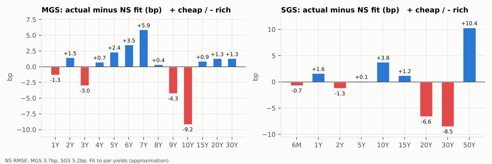
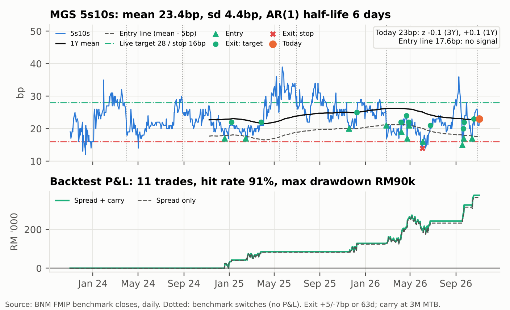

# SGD vs MYR Rates: Positioning into the 5 Nov 2026 BNM MPC

Relative-value research on the Malaysian (MGS) and Singapore (SGS) government bond curves ahead of Bank Negara Malaysia's 5 Nov 2026 policy meeting. It covers curve construction, carry and roll-down, FX-hedged cross-market value and MPC scenario P&L, all reproducible in Python.

## Summary

*Levels: MGS 3 Nov 2026 (BNM FMIP), SGS 30 Oct 2026 (MAS).*

1. **View:** BNM holds OPR at 2.75% (70%; UOB calls a hike, which we weight at 25%). The pressure on MGS is external (Fed, UST 10Y ~4.9%, foreign selling) and lands on the 10Y, the richest point on the curve (–9.2bp to Nelson-Siegel).
2. **Primary trade:** MGS 5s10s steepener on the FMIP benchmarks, DV01-neutral: buy RM19.1m MGS 4.232% 6/31, sell RM10m MGS 3.92% 10/36 (RM8,223/bp per leg). It is a **carry trade with an MPC / foreign-flow catalyst**, not a value trade.
   - **Entry 23bp, target 28bp, stop 16bp.** The target is the 3Y mean + 1 sd of 5s10s.
   - Risk 7bp (–RM57.6k) to make 5bp (+RM41.1k).
3. **Paid to wait:** +RM34.6k of 3M carry + roll (+4.2bp). P&L on the MPC day: hold +RM9.6k, +25bp –RM30.2k, –25bp +RM64.8k. Over 3M the trade is positive in all three scenarios.
4. **Alternative trade:** a cash-neutral SGD real-money switch from SGS 7Y into FX-hedged MGS 7Y, for a **+70bp hedged pickup** at matched tenor (2.82% vs 2.11%) and +RM25.7k of 3M carry + roll per RM10m.
5. **History check (3Y of daily FMIP closes):** 5s10s reverts to ~23.5bp (sd 4.4bp), so today's 23bp is not cheap (z = –0.1). The Nelson-Siegel fair value of 33.5bp is not supported as a target. The 28bp target is: from comparable entries, it was reached before the 16bp stop in 64% of 3M windows (stop first in 19%).
6. **Wrong if:** BNM opens the door to hikes, foreign selling migrates into the belly, or 5s10s breaks 16bp with OPR unchanged.

## Reports

- **[One-page trade pitch (PDF)](report/trade_pitch.pdf)** ([Markdown source](report/trade_pitch.md))
- **[Rates strategy note, 3 pages (PDF)](report/rates_note.pdf)** ([Markdown source](report/rates_note.md))
- Charts and tables: [`output/`](output/)



*MGS 10Y is the richest point on the curve (–9.2bp) and the 5–7Y belly the cheapest. This supports the steepener's direction. The target comes from history, not from the fit (see below).*

## Does history support the trade?

**Yes, as a carry trade with a catalyst, not as a value trade. History rejects the 33.5bp Nelson-Siegel fair value as a target, so we set the target at 28bp (3Y mean + 1 sd).**



*Daily FMIP benchmark closes, 1 Nov 2023 to 3 Nov 2026 (736 trading days).*

- **No dislocation:** today's 23bp equals the 3Y mean (23.4bp, sd 4.4bp, z = –0.1) and the 1Y mean (22.6bp, z = +0.1).
- **Fast mean reversion, to ~23.5bp:** AR(1) gives $\phi$ = 0.89 and a half-life of 6 trading days. The Dickey-Fuller t-statistic of –6.5 rejects a unit root.
  - The spread reverts to its long-run mean of 23.5bp, not to the 33.5bp Nelson-Siegel fair value, which it reached on only 3.7% of days.
  - On this evidence, the 10Y's richness to the fit is the normal shape of the curve. We keep the fit as context for the direction (rich 10Y, cheap belly) but not as the target. We cannot test the fit itself without a history of the full curve.
- **The target and stop come from the distribution:**
  - The target, 28bp, is $\bar s + \hat\sigma_s$; 5s10s was at or above it on 18% of days.
  - The stop, 16bp, is unchanged; 5s10s was at or below it on 3.7% of days.
  - Risk/reward is 5bp to make for 7bp to risk (0.71x), so the trade needs a hit rate of 58% before carry. The 3M carry + roll (+4.2bp, +RM34.6k) is worth 84% of the move to target. That is why we call it a carry trade.
- **The live bracket on history:** we entered on every day with 5s10s between 21 and 25bp (269 overlapping cases), with exits at +5bp / –7bp from entry (the 23 / 28 / 16bp bracket) or after 3M.
  - Target hit first: **64%**. Stop hit first: 19%. Time exit: 17%.
  - Average time to exit: 29 trading days. Average move: +1.9bp before carry.
- **Rules-based backtest:** enter when 5s10s is 5bp below its rolling 1Y mean, with the same +5 / –7bp bracket and a 63-day limit.
  - 11 closed trades, 10 winners (**91% hit rate**). Average **+RM34.2k** (+4.1bp), of which carry is +RM1.0k.
  - Average holding period: 12 trading days. Exits: 10 at target, 1 at the stop, 0 at the time limit.
  - **Max drawdown: –RM89.9k** (6 May to 12 Jun 2026). A stop-out (–RM56.7k) was followed by a re-entry that dipped further before it hit target.
  - The rule does **not** fire today: the entry line is 17.6bp.
  - Sensitivity, entering at the 1Y mean: 13 trades, 77% hit rate, average +RM28.2k, max drawdown –RM89.8k.
- **Caveat:** the 28bp target is fitted to the same 3Y history it is tested on, so these odds are in-sample and flatter the bracket.

---

## Method

### Data

The curve data is a single-date snapshot in [`data/market_snapshot.csv`](data/market_snapshot.csv), with the source and as-of date on every row. The 5s10s history is daily; see the last two rows of the table.

| Series | Source | As of |
|---|---|---|
| MGS par yields, 1–30Y | BNM FMIP YTM matrix | 3 Nov 2026 |
| MGS benchmark bonds: 4.232% 30.06.2031, 3.92% 31.10.2036 ([`data/benchmarks.csv`](data/benchmarks.csv)) | BNM FMIP benchmark yields (closing); BNM auction results | 3 Nov 2026 |
| MYR AAA corporate yields, 3/5/7/10/15Y | BNM FMIP YTM matrix | 3 Nov 2026 |
| MY T-bills (3M, 6M, 12M buckets) | BNM FMIP short-term bills, last traded | 3 Nov 2026 |
| OPR, MYOR | BNM Monetary Policy Statement (3 Sep 2026); BNM FMIP | 3 Nov / 2 Nov 2026 |
| USD/MYR | BNM KL USD/MYR reference rate | 3 Nov 2026 |
| SGS benchmark yields, 6M–50Y | MAS Daily SGS Prices (closing yields) | 30 Oct 2026 |
| S$NEER slope | Market estimate (MAS does not publish the slope) | 14 Oct 2026 MPS |
| UST 10Y (commentary only) | US Treasury daily par yield curve | 2–3 Nov 2026 |
| Foreign flows into Malaysian government bonds | Kenanga Research via Business Today | week to 23 Oct 2026 |
| **History:** MGS 3/5/7/10Y benchmark closing yields (with bond maturity and a "last traded" flag) and MTB 3M/6M/12M, daily ([`data/mgs_benchmark_history.csv`](data/mgs_benchmark_history.csv)) | [BNM FMIP Benchmark Yields](https://financialmarkets.bnm.gov.my/benchmark-yields), one page per date (`?date=YYYY-MM-DD`), via [`scripts/fetch_fmip_history.py`](scripts/fetch_fmip_history.py) | 1 Nov 2023 – 3 Nov 2026 |
| History cross-check: MGS 5Y and 10Y yields ([`data/abo_crosscheck.csv`](data/abo_crosscheck.csv)) | [AsianBondsOnline (ADB)](https://asianbondsonline.adb.org/economy/?economy=MY) Malaysia yield curve | 31 Dec 2025, 30 Oct and 2 Nov 2026 |

The history file has 785 weekdays. We drop the 49 market holidays, where FMIP repeats the previous print for every benchmark, which leaves 736 trading days. On the remaining days, a benchmark that did not trade is flagged as "last traded": 25 days for the 5Y and 15 for the 10Y. AsianBondsOnline publishes only curve snapshots, not a downloadable daily series, so it is a spot check rather than a second history. Its constant-maturity 5s10s is 1–2bp above the FMIP benchmark spread on all three dates (25.2 vs 23.0bp, 21.9 vs 21.0bp, 22.0 vs 21.0bp).

Policy context: BNM MPS (9 Jul and 3 Sep 2026), MAS MPS (Apr, Jul and Oct 2026), FOMC statements (16 Sep and 28 Oct 2026), and house views for the 5 Nov MPC ([The Edge, 3 Nov 2026](https://theedgemalaysia.com/node/824126)).

### Conventions

Curve analytics treat each tenor as a semi-annual par bond at the snapshot yield (MGS and SGS both pay semi-annually). The primary trade is priced on the actual benchmark bonds (coupon, maturity and closing yield), with an Actual/365 year fraction to maturity.
- Bond yields and zeros are semi-annually compounded.
- Time is in idealised year fractions, with coupons exactly 0.5Y apart, rather than the Actual/Actual day count of the real bonds.
- Carry, funding and the CIP hedge use simple (money-market) interest on bill yields as quoted.
- DV01 is in RM per 1bp for the stated face amount and is positive for a long position.

### Zero bootstrap

Par yields are linearly interpolated onto a 6M grid. The MGS curve is anchored at 0.5Y with the 6M T-bill. Then, for each maturity $t_n$ with par coupon $c_n$:

$$DF_n = \frac{1 - \tfrac{c_n}{2}\sum_{i \lt n} DF_i}{1 + \tfrac{c_n}{2}}, \qquad z_n = 2\left(DF_n^{-1/(2t_n)} - 1\right), \qquad f_{a,b} = 2\left[\left(\frac{DF_a}{DF_b}\right)^{\frac{1}{2(b-a)}} - 1\right]$$

### Nelson-Siegel rich/cheap

We fit the Nelson-Siegel curve below to par yields. $\lambda$ is chosen by grid search and $\beta$ by OLS. The residual is actual minus fit, in bp: positive means cheap.

$$y(\tau) = \beta_0 + \beta_1 \frac{1-e^{-\tau/\lambda}}{\tau/\lambda} + \beta_2\left[\frac{1-e^{-\tau/\lambda}}{\tau/\lambda} - e^{-\tau/\lambda}\right]$$

### Risk

Full revaluation with a ±1bp central difference:

$$\text{DV01} = \frac{P(y-1\text{bp}) - P(y+1\text{bp})}{2}, \qquad D_{mod} = \frac{\text{DV01}}{P \cdot 10^{-4}}, \qquad C = \frac{P_+ + P_- - 2P}{P\,(10^{-4})^2}$$

DV01-neutral sizing (primary): $N_{\text{long}} = N_{\text{short}} \cdot \text{DV01}_{\text{short}} / \text{DV01}_{\text{long}}$. Cash-neutral sizing (alternative, a real-money switch): $N_{\text{short}} = N_{\text{long}} \cdot P_{\text{long}} / P_{\text{short}}$.

### 3M carry and roll-down ($h = 0.25$)

$$\text{Carry} = (y - r_{\text{fund}})\,P^{\text{dirty}}\,h, \qquad \text{Roll} = P^{\text{clean}}_{T-h}\big(y(T-h)\big) - P^{\text{clean}}_{T-h}\big(y(T)\big), \qquad \text{Breakeven (bp)} = \frac{\text{Carry} + \text{Roll}}{\text{DV01}}$$

Yield carry includes the pull-to-par of a premium bond; for a par bond it reduces to $(c - r_{\text{fund}})\cdot 100\cdot h$. For the real-money switch there is no repo: the MGS leg is charged the FX hedge cost and the SGS leg forgoes its yield, so carry is the hedged yield difference.

### FX-hedged MGS yield for an SGD investor (covered interest parity)

$S$ and $F$ are quoted in MYR per SGD:

$$F = S\,\frac{1 + r_{\text{MYR}}\,\tau}{1 + r_{\text{SGD}}\,\tau} \;\Rightarrow\; \text{hedge cost} = \frac{F - S}{S\,\tau} = \frac{r_{\text{MYR}} - r_{\text{SGD}}}{1 + r_{\text{SGD}}\,\tau}, \qquad y^{\text{SGD-hedged}}_{\text{MGS}} \approx y_{\text{MGS}} - \text{hedge cost}$$

> **Approximation:** the forward points are *not* market quotes. They are implied from short-rate proxies: 3M MY T-bill 2.98% vs SGS 6M 1.91%, giving 106.5bp p.a. on a rolling 3M hedge (114.8bp on a 1Y matched hedge). Real MYR hedges price off onshore forwards or offshore NDFs, which carry a basis to this.

### MPC scenarios

Explicit curve shifts per tenor are in [`data/mpc_scenarios.csv`](data/mpc_scenarios.csv): hold, +25bp (bear flattener) and –25bp (bull steepener).
- Shifts between nodes are linearly interpolated.
- P&L is a full revaluation.
- The 3M total adds carry + roll.
- For the hedged leg, the 3M forward is marked to the change in the rate differential.

### History and backtest

The spread is $s_t = y^{10Y}_t - y^{5Y}_t$, using FMIP benchmark closes in bp. Over the $N = 736$ trading days, and over the last 252 for the 1Y version:

$$\bar s = \frac{1}{N}\sum_t s_t, \qquad \hat\sigma_s = \sqrt{\frac{1}{N-1}\sum_t (s_t - \bar s)^2}, \qquad z = \frac{s_{\text{today}} - \bar s}{\hat\sigma_s}$$

Mean reversion is an OLS AR(1) on daily closes:

$$s_t = a + \phi\, s_{t-1} + \varepsilon_t, \qquad h = \frac{\ln 0.5}{\ln \hat\phi}, \qquad \mu = \frac{\hat a}{1 - \hat\phi}, \qquad t_{DF} = \frac{\hat\phi - 1}{\operatorname{se}(\hat\phi)}$$

$h$ is the half-life in trading days and $\mu$ the long-run mean. $t_{DF}$ is the Dickey-Fuller statistic; its 5% critical value with a constant is about –2.86.

**Live levels.** The target is set from the history; the Nelson-Siegel fair value is context only:

$$T = \operatorname{round}(\bar s + \hat\sigma_s) = \operatorname{round}(23.4 + 4.4) = 28\text{bp}, \qquad S = 16\text{bp}, \qquad \frac{T - s_{\text{today}}}{s_{\text{today}} - S} = \frac{5}{7}, \qquad p^{*} = \frac{s_{\text{today}} - S}{T - S} = 58\%$$

Here $p^{*}$ is the breakeven hit rate before carry and time exits.

**Backtest rule.** Enter the steepener at the close when $s_t \le m_t - X$, where $m_t = \frac{1}{252}\sum_{k=0}^{251} s_{t-k}$ is the rolling 1Y mean and $X = 5$bp (sensitivity: 0 and 10bp). The exit is at the first close where the position has moved $+(T - s_{\text{today}}) = +5$bp (target) or $-(s_{\text{today}} - S) = -7$bp (stop) from entry, or after 63 trading days (time exit). That is the live trade's bracket over its 3M horizon. Only one position is open at a time. The first year of data seeds $m_t$, so trades run from Nov 2024.

**Sizing and P&L.** Each trade shorts RM10m of the 10Y par bond and buys the 5Y par bond for the same DV01, with both fixed at entry: $N_{10} = 10\text{m}$, $D = N_{10}\,\text{DV01}_{10}/100$ and $N_5 = N_{10}\,\text{DV01}_{10}/\text{DV01}_5$. Daily P&L is

$$\text{P\&L}_t = D\,\Delta\tilde s_t + \left[N_5\,(y^{5Y}_{t-1} - r_{t-1}) - N_{10}\,(y^{10Y}_{t-1} - r_{t-1})\right]\frac{\Delta d_t}{365}$$

- $r$ is the 3M MTB, the same repo proxy as the pitch, and $\Delta d_t$ is the number of calendar days in the period.
- $\Delta\tilde s_t = \Delta s_t$, except on the 6 benchmark-switch days, where it is 0. On those days the position rolls into the new benchmark bonds at the close, and the switch jumps (–8bp to +2bp) are not P&L.
- Between switches each benchmark is a single bond, so $D\,\Delta\tilde s$ already contains the roll-down. No separate roll term is added.
- Hit rate counts closed trades with P&L > 0. Max drawdown is the largest peak-to-trough fall of cumulative daily P&L.

**Live-setup odds.** We enter on every day with $21 \le s_t \le 25$bp, in overlapping windows, and record whether +5bp or –7bp is reached first within 63 days.

### Assumptions

- **MYR funding (primary):** 3M T-bill, 2.98%. This is more conservative than MYOR at 2.75%; MYOR would add ~RM5.6k of 3M carry to the primary trade.
- **SGD funding and hedge leg:** SGS 6M at 1.91%. The snapshot has no SORA or 3M SGD rate.
- **MGS bootstrap anchor:** the 6M T-bill (3.03%) is used at 0.5Y. The 12M bill is used only for the 1Y matched hedge cost.
- **Trade sizing:** anchored on RM10m. That is the MGS 10/36 short for the primary trade and each leg of the cash-neutral alternative.
- **Benchmark roll:** each benchmark bond keeps a constant spread to the par curve as it rolls down.
- **SGS 7Y:** linearly interpolated between the 5Y and 10Y benchmarks; it is the short leg of the alternative trade.
- **Scenario P&L:** instantaneous, with no carry on the MPC day.

## How to reproduce

Requires Python 3.10+. Tested with Python 3.13.

```bash
pip install -r requirements.txt
```

```bash
make
```

`make` runs the analytics (writing tables, charts and `summary.json` to `output/`) and then the test suite. Without `make`:

```bash
python3 -m src.main && python3 -m pytest -q
```

Optional: rebuild the report PDFs. This needs pandoc and Node with Playwright/Chromium.

```bash
make pdf
```

Optional: refresh the history from FMIP (about 2s per request; resumable).

```bash
python3 scripts/fetch_fmip_history.py --start 2023-11-01 --end 2026-11-03
```

Layout:
- `data/`: market snapshot, scenario assumptions, daily FMIP benchmark history and the AsianBondsOnline cross-check
- `scripts/fetch_fmip_history.py`: rebuilds the history file from FMIP (resumable, one request per weekday)
- `src/`: analytics
  - `curves`: bootstrap, Nelson-Siegel
  - `bonds`: pricing and risk
  - `carry`
  - `rv`: cross-market and credit
  - `trades`: sizing and scenarios
  - `history`: 5s10s statistics, AR(1), backtest
  - `charts`
- `tests/`: 19 unit and regression tests
- `report/`: trade pitch and rates note (Markdown and PDF)
- `output/`: figures and tables

## Limitations

- **Mostly a single-date snapshot.** Only MGS 5s10s has history (3Y of daily FMIP benchmark closes). The curve fit, carry, cross-market and credit analytics are one-day, so there are no z-scores, betas or vol for them. The scenario moves are judgement, not regression. The alternative is sized cash-neutral, not beta-weighted, so it carries a small net short duration (–RM396/bp per RM10m).
- **Backtest caveats.**
  - The sample is small: 5 closed trades in 2 years, with overlapping 3M windows for the odds.
  - P&L uses a DV01 approximation on par-bond sizing, with no convexity and no bid-offer.
  - The P&L on benchmark-switch days is set to zero.
  - "Last traded" prints are used as quoted.
  - History carry uses the 3M MTB, which sat closer to 5Y yields before 2025, so historical carry (+RM4k per trade) is smaller than today's.
  - The X = 5bp rule and the 21–25bp band were set before the backtest was run. The 3M horizon and 16bp stop come from the live trade.
  - The 28bp target ($\bar s + \hat\sigma_s$) is estimated on the same 3Y history the backtest runs on. The bracket odds and hit rates are therefore in-sample and likely flatter the trade.
- **Mixed snapshot dates.** SGS levels are from 30 Oct 2026 and MGS levels from 3 Nov 2026.
- **Par-curve approximation.**
  - The curve analytics use the FMIP par/YTM matrix, not individual bonds, so specialness and benchmark effects are not captured. Only the primary trade is priced on actual bonds.
  - The MGS 10/36 coupon is taken as 3.92%, as shown on FMIP to 2 decimal places.
  - Linear par interpolation creates kinks in the forwards.
  - Nelson-Siegel is fitted to par rather than zero yields.
  - MGS 1Y roll-down reads as zero because the curve starts at 1Y.
- **No MYR IRS, OIS or KLIBOR data.** There is no swap-spread, asset-swap or market-implied MPC pricing. Scenario probabilities (70/25/5) are subjective. Funding uses bills as repo proxies.
- **FX hedge from CIP on bill proxies.** There are no NDF or onshore forward points and no cross-currency basis. The SGD/MYR spot is not in the snapshot, so SGS legs are expressed in RM-equivalent notional.
- **Data caveats:**
  - MY T-bills are FMIP last-traded maturity buckets, not constant-maturity yields.
  - The S$NEER slope (~1.25% p.a.) is a market estimate, because MAS does not publish it.
  - UST 10Y is approximate and used only in commentary.
  - The foreign-flow figure covers Malaysian government bonds, and the MGS/GII split is not reported.
  - The Q4 2026 MGS/GII auction calendar is not covered.

---

**Huwa Jia Wei**, NUS Economics & Statistics

*Research illustration, not investment advice. Code released under the [MIT License](LICENSE). Market data remain subject to the terms of their original publishers (BNM, MAS, US Treasury, ADB AsianBondsOnline).*
