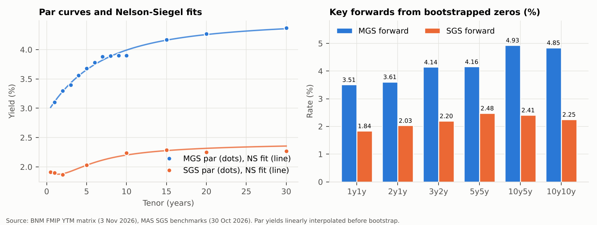
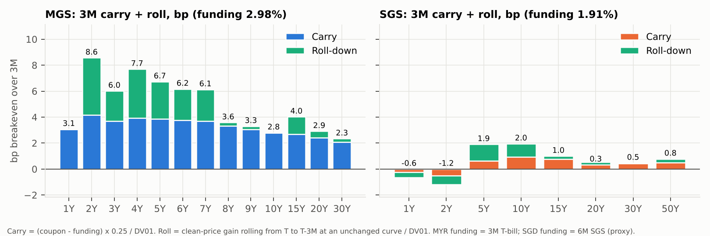
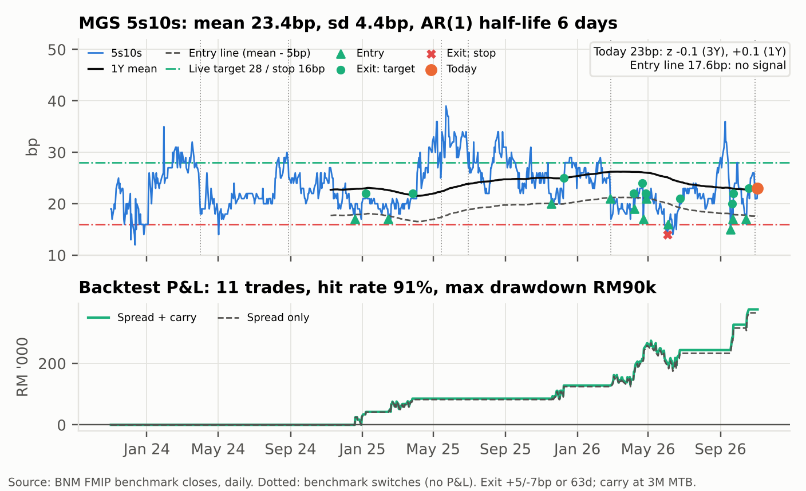
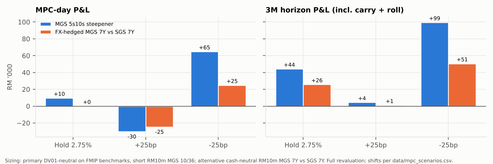

## Summary

- **BNM:** we expect a hold at 2.75% on 5 Nov, in line with consensus. UOB calls a hike; we weight it at 25%. The MGS front end already embeds a premium over OPR: 1Y 3.10%, 1y1y forward 3.51%. A hold should let that premium bleed rather than build.
- **Curve:** the pressure point is the long end. A Fed hike, UST 10Y near 4.9% and foreign selling of MGS all lean on the 10Y, which is the richest point on our Nelson-Siegel fit (–9.2bp).
- **Primary trade, MGS 5s10s steepener:** a carry trade with an MPC / foreign-flow catalyst, on the FMIP benchmarks (MGS 6/31 vs 10/36). Entry 23bp, target 28bp (3Y mean + 1 sd), stop 16bp. It earns +4.2bp of carry + roll per 3M and is positive over 3M in hold, hike and cut.
- **Alternative trade, for SGD real money:** switch SGS 7Y into FX-hedged MGS 7Y, cash-neutral, for a **+70bp hedged pickup** at matched tenor.
- **History check:** 5s10s mean-reverts to ~23.5bp (sd 4.4bp), so 23bp is not cheap (z = –0.1) and the 33.5bp Nelson-Siegel fair value is not a credible target. The target comes from the history instead.

## Market recap

MGS trades as a two-speed curve. The front end and belly are steep: 2s5s is 38bp and 3s7s is 48bp. The 7–10Y sector is flat: 7s10s is 2bp and 9s10s is 0bp. 10s15s then jumps 27bp. Bills sit at 2.98% (3M) to 3.07% (12M), 23–32bp over OPR and MYOR (both 2.75%).

SGS is flat and anchored: 2Y 1.87%, 10Y 2.24%, 30Y 2.27%. The 1s2s segment is mildly inverted after the MAS S$NEER tightenings. MGS–SGS spreads run from 143bp (2Y) to 210bp (30Y).

The external backdrop is hostile for EM duration. The Fed hiked in September and UST 10Y is ~4.9%. Foreigners sold a net RM3.7b of Malaysian government bonds in the week to 23 Oct. Middle East and oil risk keeps an inflation tail alive.

## Policy view

**BNM (5 Nov): hold at 2.75%, balanced tone.** Domestic inflation does not argue for a hike. A hike to defend the ringgit against a hiking Fed is a tail, not the base case: BNM has historically preferred FX operations and flow measures to rate defence. The risk is a *hawkish hold*. If the statement leans on imported inflation (oil) or the ringgit, the market will add hike premium at 1–3Y. A cut is very unlikely with the Fed hiking and foreigners selling.

**The hike case.** UOB (Julia Goh, Jasrine Koke) expects a 25bp hike to 3.00% on Thursday. It cites the September guidance shift, stronger-than-expected 3Q advance GDP and an expansionary Budget 2027 ([The Edge, 3 Nov](https://theedgemalaysia.com/node/824126)). It is a minority call: eight of nine economists in the same poll expect a hold. We take it seriously but fade it for this meeting, for three reasons:

1. **The September statement removed a dovish anchor; it did not pre-commit to a move.** It dropped "appropriate" from the stance sentence but kept its "remain vigilant … assess the balance of risks" language unchanged.
2. **Inflation is falling.** The same statement said inflation had "edged lower", and headline CPI was 1.8% in September. A hike into falling inflation is hard to justify.
3. **The budget argues for 2027, not November.** Budget 2027's minimum-wage and cash-assistance measures act on prices mostly in 2027. That supports a move in early 2027: Juwai IQI, for example, expects a hike in 1Q27 ([Bernama via Utusan Sarawak](https://utusansarawak.com.my/bnm-dijangka-kekalkan-kadar-opr/)).

We still lift the hike weight from 15% to 25% to reflect the shift in guidance. If BNM does hike, the steepener loses RM30.2k on the day but stays positive over 3M (+RM4.4k).

Our subjective weights: **hold 70%, hike 25%, cut 5%**. These are not market-implied: there is no MYR OIS/IRS in the snapshot.

**MAS: on hold after two tightenings.** MAS left the rate of appreciation of the S$NEER band unchanged on 14 Oct, after raising it in April and July (market estimate of the slope ~1.25% p.a.; MAS does not publish it). With SGD appreciation doing the work, SGS front-end yields stay pinned near 1.9%. That keeps the SGD leg of any MYR hedge cheap to fund and the MYR–SGD rate differential wide, at ~106.5bp p.a. on 3M proxies.

{width=75%}

## Curve and relative value

**Rich/cheap.** We fit Nelson-Siegel to the MGS par curve (λ = 3.7, RMSE 3.7bp).

- **Rich:** the 9–10Y sector is the outlier (9Y –4.3bp, 10Y –9.2bp). This is the benchmark-scarcity / real-money-demand point.
- **Cheap:** 5–7Y screens cheap (5Y +2.4bp, 6Y +3.5bp, 7Y +5.9bp).
- **Implied fair value:** 5s10s at 33.5bp vs 22bp on the par curve (23bp on the benchmarks), and 7s10s at ~17bp vs 2bp. This is context for the direction, not the target: over three years 5s10s has averaged 23bp (see below).
- **SGS (RMSE 5.2bp):** 5Y sits on the fit (+0.1bp) and 10Y screens cheap (+3.8bp). 20–30Y look rich (–6.6/–8.5bp) against a cheap 50Y (+10.4bp).

**Carry and roll.** Over 3M, with MYR funding at the 3M bill (2.98%), the belly is the sweet spot:

- **4–7Y:** breakevens of 6.1–7.7bp. The 4Y rolls 4.0bp and the 5Y 3.0bp.
- **8–10Y:** 2.8–3.6bp. The flat 7–10Y sector gives the 10Y no roll at all.
- **2Y:** 8.6bp, highest on the curve, but this is the point most exposed to a hawkish surprise.
- **SGS:** under 2bp everywhere, and negative at 1–2Y because of the inverted front end.

{width=75%}

**Cross-market and credit.**

| Tenor | MGS–SGS | FX-hedged MGS for an SGD investor | Hedged pickup vs SGS | AAA–MGS |
|---|---:|---:|---:|---:|
| 5Y | 165bp | 2.62% | +59bp | 44bp |
| 7Y | 177bp* | 2.82% | +70bp* | 41bp |
| 10Y | 166bp | 2.84% | +60bp | 49bp |
| 15Y | 188bp | 3.11% | +82bp | 40bp |

::: fn
\* SGS 7Y interpolated. Hedge cost from covered interest parity with 3M MY T-bill (2.98%) vs SGS 6M (1.91%) as short-rate proxies: $\dfrac{r_{\text{MYR}} - r_{\text{SGD}}}{1 + r_{\text{SGD}}\,\tau} = 106.5$bp p.a. (114.8bp on a 1Y matched hedge). This approximation ignores the NDF/onshore basis.
:::

- **Hedged pickup:** for an SGD investor, MGS beats SGS by 59–82bp across 5–15Y even after hedging. At a matched 7Y, the cheap MGS 7Y gives +70bp over SGS: the basis of the alternative trade.
- **Credit:** AAA–MGS spreads are tight and flat (40–49bp). The 10Y AAA spread (49bp) is wide to its 7Y and 15Y neighbours, but that mostly reflects the rich 10Y MGS benchmark rather than cheap credit. We prefer expressing the 10Y richness on the govvie curve.

## Flows and supply

- **Foreign flows are the swing factor.** The RM3.7b weekly outflow fits a pattern of foreign real money cutting EM duration as UST yields rise. Foreign holdings typically concentrate in benchmark 5–10Y MGS, so further selling hits the 10Y hardest. That is the steepener's main tailwind.
- **Local demand is the offset.** Pension funds, lifers and bank ALM desks are structural buyers of 10Y+ duration. Year-end portfolio rebalancing can keep the 10Y rich.
- **Auction supply:** the remaining Q4 2026 MGS/GII auction calendar is not covered here, so check BNM's issuance calendar before execution. A 10Y reopening or new benchmark would cheapen the short leg, which is a positive for the trade. Heavy 5Y supply is the risk to the long leg.

## Does history support the trade?

{.right width=50%}

**Yes as a carry trade with a catalyst; no as a value trade.** Data: daily FMIP benchmark closes, 1 Nov 2023 to 3 Nov 2026 (736 days; AsianBondsOnline agrees within 1–2bp on spot dates).

- **No dislocation.** 5s10s averaged 23.4bp (sd 4.4bp, range 12–39bp). Today's 23bp gives $z = (23 - \bar s)/\hat\sigma_s = -0.1$ over 3Y, and +0.1 against the 1Y mean of 22.6bp.
- **Reverts to ~23.5bp, not to NS fair value.** The AR(1) $s_t = a + \phi s_{t-1} + \varepsilon_t$ gives $\hat\phi = 0.89$, a half-life of $\ln 0.5/\ln\hat\phi = 6$ trading days, and a Dickey-Fuller t-statistic of –6.5. The long-run mean is $\hat a/(1-\hat\phi) = 23.5$bp. 5s10s reached the 33.5bp NS fair value on only 3.7% of days.
- **Levels from history.** Target $\bar s + \hat\sigma_s = 28$bp (5s10s was at or above it on 18% of days); the 16bp stop is unchanged (3.7% of days).
  - Risk 7bp (–RM57.6k) to make 5bp (+RM41.1k), 0.71x, so the breakeven hit rate is 58% before carry.
  - 3M carry + roll (+RM34.6k) is worth 84% of the move to target.
- **The bracket on history.** From every day with 5s10s at 21–25bp, 23→28/16 hit the target first 64% of the time and the stop 19%; 17% timed out at 3M. Exits took 29 days on average.
- **Backtest.** Enter 5bp below the rolling 1Y mean with the same +5/–7bp bracket; DV01-neutral on a RM10m 10Y short, carry at the 3M bill.
  - 11 closed trades, 91% hit rate, average +RM34.2k, average hold 12 days, max drawdown –RM89.9k.
  - It does not fire today: the entry line is 17.6bp.
  - The 28bp target is fitted to the same history, so these odds are in-sample.

## Trade ideas

| | Primary: MGS 5s10s steepener | Alternative: hedged MGS 7Y vs SGS 7Y |
|---|---|---|
| Size (per RM10m) | Buy RM19.1m MGS 4.232% 6/31 / sell RM10m MGS 3.92% 10/36 | Buy RM10m MGS 7Y (3M FX hedge) / sell RM10m-eq. SGS 7Y (cash-neutral) |
| DV01 | RM8,223/bp per leg, net 0 | RM6,079 vs RM6,475/bp, net –RM396/bp |
| Entry / target / stop | 23 / 28 / 16bp (risk 7bp to make 5bp) | 177 / 162 / 187bp |
| 3M carry + roll | +RM34.6k (+4.2bp) | +RM25.7k (carry = hedged yield difference, no repo) |
| P&L: hold / hike / cut | +9.6k / –30.2k / +64.8k | 0.0k / –24.7k / +24.8k |
| 3M incl. carry: hold / hike / cut | +44.2k / +4.4k / +99.4k | +25.7k / +1.0k / +50.5k |

The steepener is the cleaner trade: its target is backed by three years of history and it earns more carry + roll (RM34.6k vs RM25.7k). The 3M carry + roll alone covers the full hike-scenario loss, a 3.7bp bear flattening between the 6/31 and the 10/36.

{width=75%}

## Risks

1. **Hawkish hold or hike.** A bear flattener costs ~RM8.2k per bp of 5s10s flattening per RM10m 10Y leg. The stop at 16bp caps the loss at ~RM58k, against +RM41k at the 28bp target.
2. **10Y squeeze.** Year-end real-money demand or index buying keeps the 10Y rich.
3. **Long-end-led UST rally.** It would bull-flatten MGS in sympathy.
4. **Alternative trade only:**
   - The hedge cost re-prices higher on a BNM hike. The forward is locked for 3M, so this hits carry beyond the first roll.
   - SGS richens on regional risk-off.
   - The NDF and onshore forward basis diverges from our CIP proxy.

## Implications for a bank Treasury / ALM book

For a bank holding MGS/GII as Level 1 HQLA, the same analysis argues for concentrating the liquidity buffer in the 4–7Y belly rather than the 10Y. At the same DV01, the belly earns 6–8bp of carry + roll per quarter versus 2.8bp, and it holds the cheapest points on the curve. The constraint is the FVOCI mark: in the hike scenario, a RM1b 10Y book (~RM0.82m/bp) loses ~RM4m of OCI on a 5bp move, straight through CET1. Rotating 10Y holdings into the belly at matched DV01 keeps NII carry and lowers ΔEVE under an IRRBB steepener shock. For an SGD-based treasury with surplus MYR liquidity, the hedged pickup argues for holding short-to-belly MGS rather than interbank placements, with the FX hedge booked in the banking book and the NDF/onshore basis monitored.

Sources: BNM FMIP (MGS and AAA YTM matrix, MGS benchmark yields, MY T-bills, MYOR, KL USD/MYR reference rate; 3 Nov 2026; daily MGS benchmark closes and MTB, 1 Nov 2023–3 Nov 2026); AsianBondsOnline (5s10s cross-check); BNM auction results (MGS 4/2026); BNM Monetary Policy Statements; MAS Daily SGS Prices (30 Oct 2026) and Monetary Policy Statements; FOMC statements (16 Sep and 28 Oct 2026); US Treasury par yield curve; Kenanga Research via Business Today (foreign flows, week to 23 Oct); The Edge and Bernama (house views, 3 Nov). The S$NEER slope level is a market estimate. Curve analytics are a single-date snapshot; only 5s10s has history; par yields linearly interpolated; no MYR IRS or OIS data. Scenario curve shifts are explicit assumptions (data/mpc_scenarios.csv). Not investment advice.

