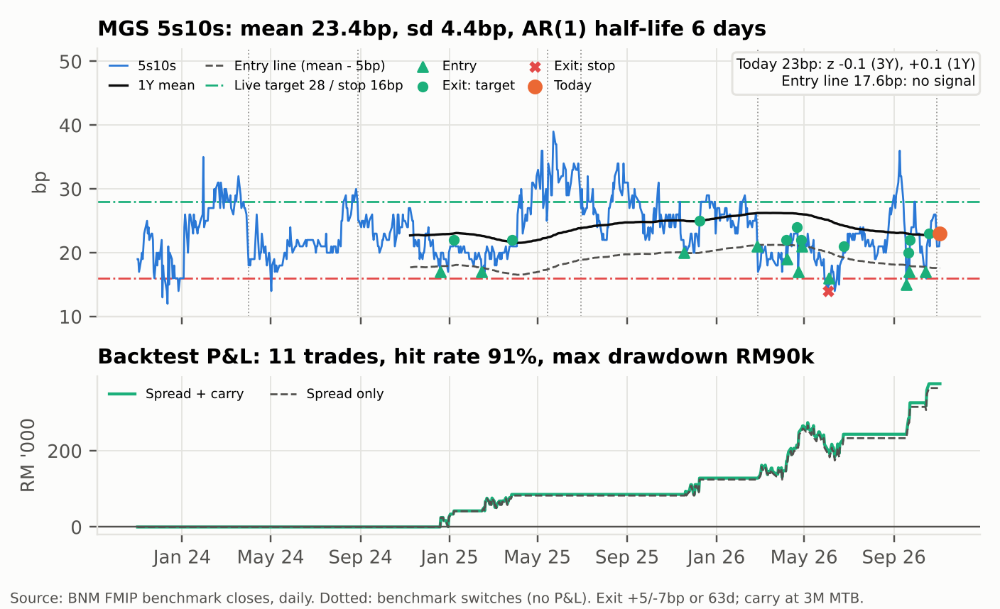

**View.** BNM holds OPR at 2.75% (consensus; UOB calls a 25bp hike, which we weight at 25%). It does not need to hike: the MGS front end already prices a tightening/term premium (1y1y forward 3.51% vs OPR 2.75%). The pressure on MGS comes from outside: Fed hiking, UST 10Y ~4.9%, foreign selling (–RM3.7b in the week to 23 Oct). That pressure lands on the most foreign-held point, the 10Y, which is also the richest point on the curve. **Own the belly, fund it with a short in the 10Y, and get paid carry while the MPC and flows do the work.**

### Primary: MGS 5s10s steepener (DV01-neutral carry trade with an MPC/flow catalyst)

::: kv
| | |
|---|---|
| Position (per RM10m) | **Buy RM19.1m MGS 4.232% 6/31 / Sell RM10.0m MGS 3.92% 10/36** (FMIP benchmarks). DV01 RM8,223/bp per leg (~USD2,017), net 0 |
| Entry / target / stop | **23bp / 28bp / 16bp** on benchmark yields (3.67% / 3.90%). Target = 3Y mean + 1 sd (23.4 + 4.4bp). Risk 7bp (–RM57.6k) to make 5bp (+RM41.1k): 0.71x, breakeven hit rate 58% before carry |
| Rich/cheap (context) | 5Y +2.4bp cheap, 10Y –9.2bp rich to NS (fair 5s10s 33.5bp): supports the direction, not the target |
| 3M carry + roll | **+RM34.6k (+4.2bp of spread)**: carry +RM11.2k, roll +RM23.4k; worth 84% of the move to target |
:::

### Alternative: FX-hedged MGS 7Y vs SGS 7Y (SGD real-money switch)

::: kv
| | |
|---|---|
| Position (per RM10m) | **Sell RM10m-equiv. SGS 7Y, buy RM10m MGS 7Y hedged to SGD on a rolling 3M forward** (cash-neutral). DV01 RM6,079 vs RM6,475/bp, net –RM396/bp |
| Entry / target / stop | MGS 7Y – SGS 7Y **177bp / 162bp / 187bp** |
| Value | MGS 7Y screens +5.9bp cheap (the cheapest point on the curve). **Hedged pickup +70bp** at matched tenor (2.82% vs SGS 7Y 2.11%, interpolated) |
| 3M carry + roll | **+RM25.7k**: carry +RM17.5k (the hedged yield difference; no repo), roll +RM8.2k. Buys into the foreign outflow, with FX hedged |
:::

### MPC scenario P&L (RM '000; full revaluation; curve shifts in `data/mpc_scenarios.csv`)

| Scenario (prob.) | MGS 2Y/5Y/10Y, bp | Primary: MPC day | Primary: 3M total | Alt: MPC day | Alt: 3M total |
|----------------|--------------------|----------------:|----------------:|---------------:|---------------:|
| Hold 2.75% (70%) | –2/0/+1 | **+9.6** | **+44.2** | 0.0 | +25.7 |
| +25bp hike (25%) | +15/+8/+5 bear flat. | –30.2 | **+4.4** | –24.7 | +1.0 |
| –25bp cut (5%) | –18/–10/–3 bull steep. | +64.8 | +99.4 | +24.8 | +50.5 |
| Probability-weighted | | +2.4 | +37.0 | –4.9 | +20.8 |

*Probabilities are a subjective desk call. The snapshot has no MYR OIS/IRS, so they are not market-implied. The 3M total assumes the shock persists and adds carry + roll.*

### Does history support the trade? Yes as carry plus a catalyst; no as value

{.right width=42%}

**5s10s mean-reverts to ~23.5bp, not to NS fair value.** On 3Y of FMIP daily closes it averaged 23.4bp (sd 4.4bp), so today's 23bp has z = –0.1. The AR(1) half-life is 6 days. It reached 33.5bp on only 3.7% of days, so the target is set at mean + 1 sd (28bp).

**The bracket works on history.** From 21–25bp entries, 23→28/16 hit the target first 64% of the time and the stop 19%, after 29 days on average. Buying 5bp below the 1Y mean won 10 of 11 trades (average +RM34k, max drawdown –RM90k), but it does not fire today (line 17.6bp). The target is fitted in-sample, so these odds flatter it.

**Why the primary over the alternative:** both trades are positive over 3M in all three scenarios. The steepener earns more carry + roll in RM (RM34.6k vs RM25.7k) for the same ~4.2bp per bp of MGS DV01, has a history-backed target, and has asymmetric bull-steepening upside if BNM turns dovish. The alternative is the client-flow expression of the same view. It carries hedge-roll and SGS liquidity risk the steepener does not.

**Key risks.** (1) A hawkish hold or a hike flattens 5s10s: –RM30.2k on the day, about 11 weeks of carry + roll. (2) Local real money (lifers, pension funds) chases the 10Y benchmark at year-end and it richens further. (3) A UST rally led by the long end bull-flattens MGS. (4) Alternative only: the MYR–SGD rate differential widens (hedge cost ~106.5bp p.a. now), or MAS tightening richens SGS.

**What would make us wrong.** BNM guidance that opens the door to hikes (watch the statement's language on inflation and the ringgit). Foreign selling migrating from the 10Y into the 3–5Y belly. Or 5s10s flattening through 16bp *despite* no change in OPR. That last one would mean the 10Y richness is structural demand, not a dislocation, and we would cut.

Sources: BNM FMIP (MGS YTM matrix and benchmark yields, MY T-bills, MYOR; 3 Nov 2026; daily benchmark closes from 1 Nov 2023), AsianBondsOnline (cross-check), BNM MPS (OPR), MAS Daily SGS Prices (30 Oct 2026), FOMC statements, US Treasury par curve, Kenanga Research (foreign flows, week to 23 Oct), The Edge (UOB call, 3 Nov). MYR funding = 3M T-bill 2.98%. SGD funding/hedge = SGS 6M 1.91% (proxy; no SORA in the snapshot). The CIP hedge cost uses short-rate proxies, not traded NDF/onshore forward points. Not investment advice.

